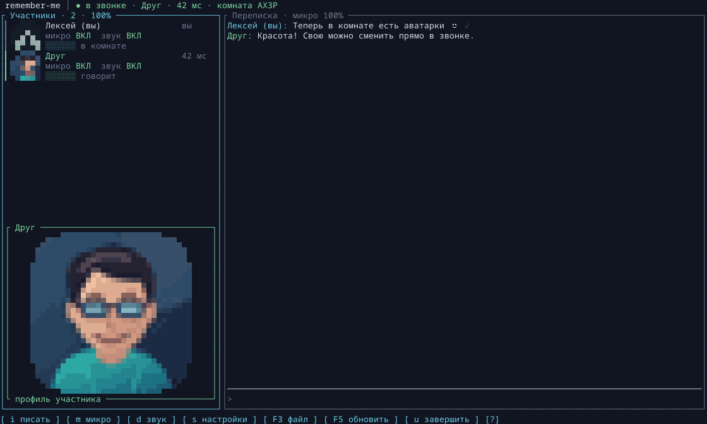
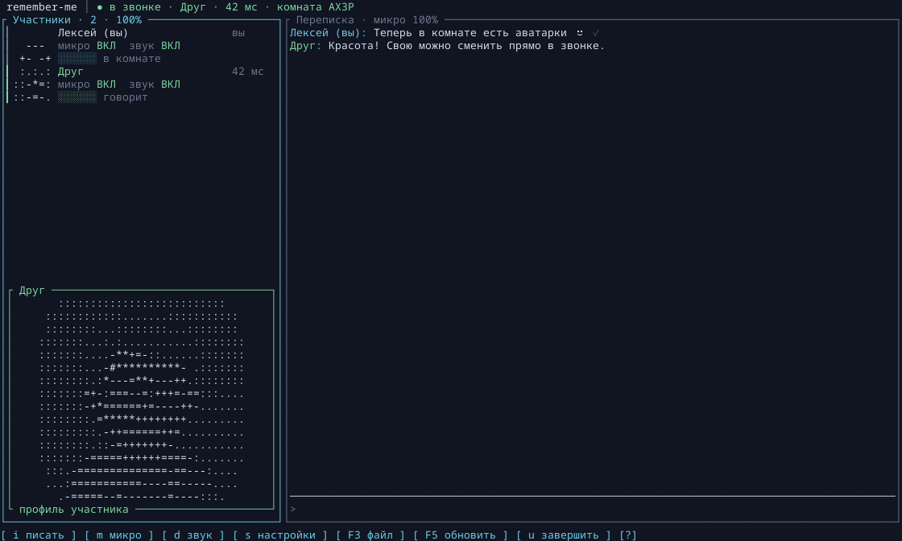

# remember-me

Личные звонки и групповые комнаты до 16 человек + чат, файлы и аватарки в терминале. Rust, ratatui. Стек: ratatui 0.30 +
crossterm + cpal + libopus (Linux: системный, Windows: встроенный) + XChaCha20-Poly1305 +
X25519.

Прямой личный звонок работает по UDP с подтверждением входящего вызова.
Групповые комнаты используют свой UDP-ретранслятор на VPS и не зависят
от Discord-аккаунта или серверов Discord.

## Сборка

```sh
cargo build --release
```

libopus — системная зависимость: на Arch это пакет `opus`, на Debian —
`libopus-dev`.

Запуск хоста и звонящего:

```sh
./target/release/remember-me --host                       # ждать входящего
./target/release/remember-me --connect 192.168.0.112:51500
```

Без флагов открывается главный экран: `[H]` host, `[C]` connect,
`[S]` настройки, `[Q]` выход.

## Windows

Готовая сборка для **Windows 10/11 x64**:
[скачать remember-me.exe](https://github.com/Prycom/remember-me/releases/download/test/remember-me.exe).
Это один переносимый файл: Opus и runtime C встроены, отдельные DLL,
Rust и PulseAudio на компьютере пользователя не нужны. Звук работает
через системный WASAPI.

Сохраните EXE в свою папку, откройте её в Windows Terminal / PowerShell
и запустите:

```powershell
.\remember-me.exe
# Сразу подключиться к комнате на VPS:
.\remember-me.exe --connect КОД@IP_СЕРВЕРА:51900
# Проверка UDP без открытия микрофона:
.\remember-me.exe --check-server IP_СЕРВЕРА:51900
```

Настройки хранятся в `%APPDATA%\remember-me\config.toml`, принятые файлы —
в `%USERPROFILE%\Downloads` или папке из F2. При первом запуске разрешите
приложению доступ к микрофону и нужный UDP-трафик в настройках Windows.
Все функции совместимы с Linux-клиентами и тем же сервером на VPS.

Автообновление и **F5** выбирают Windows-сборку, проверяют SHA-256 и
заменяют EXE без обрыва текущего звонка. После обновления закройте
и снова запустите клиент. Папка с EXE должна быть доступна для записи.

Для самостоятельной сборки нужны Rust stable MSVC, Visual Studio Build
Tools с компонентом «Desktop development with C++» и CMake:

```powershell
$env:CARGO_TARGET_X86_64_PC_WINDOWS_MSVC_RUSTFLAGS = '-C target-feature=+crt-static'
cargo build --release --locked --bin remember-me --target x86_64-pc-windows-msvc
```

Результат: `target\x86_64-pc-windows-msvc\release\remember-me.exe`.
GitHub Actions собирает и тестирует Linux и Windows перед обновлением релиза.

## Звонок через сервер (владельцу сервера)

Для VPS доступен отдельный бинарник `remember-me-server`. Он не включает
клиентский интерфейс, захват звука, Opus или ALSA/PulseAudio. Статическая
сборка для **Linux x86_64** через musl не требует установки `libopus`,
`libasound`, glibc или других разделяемых библиотек на сервере.

На машине сборки (Rust нужен только здесь):

```sh
rustup target add x86_64-unknown-linux-musl
cargo build --locked --release --no-default-features \
  --bin remember-me-server --target x86_64-unknown-linux-musl
```

Перенесите на VPS один файл:
`target/x86_64-unknown-linux-musl/release/remember-me-server`.
На VPS запускайте:

```sh
chmod +x remember-me-server
./remember-me-server -p 51900
```

Для постоянной работы используйте systemd или контейнер. Архитектура
VPS должна совпадать с архитектурой сборки: этот файл для `x86_64`,
для ARM нужен другой target и отдельная сборка.

Старый режим сервера в клиентском бинарнике также остаётся доступен:

```sh
# на VPS (port 51900 по умолчанию):
./target/release/remember-me --server
```

### Диагностика дозвона через VPS

После обновления сервера проверьте путь UDP **с каждого компьютера**:

```sh
./target/release/remember-me --check-server IP_СЕРВЕРА:51900
# Или тем же статическим бинарником, без аудиобиблиотек:
./remember-me-server --check-server IP_СЕРВЕРА:51900
```

Команда отправляет три запроса с разными идентификаторами и ждёт
соответствующие ответы. `получено 3/3 ответов` подтверждает путь UDP в
обе стороны для этого клиента. `0/3` означает, что ответа не было:
проверьте правильность адреса, актуальность серверного бинарника,
входящий/исходящий UDP в файрволе VPS и правилах провайдера. При запуске
в Docker порт нужно публиковать именно как `51900:51900/udp`.

Для старого парного протокола сервер пишет события регистрации и выхода, пересылку `HELLO`,
`INCOMING`, `ACCEPT`, `DECLINE`, `BYE`, а также каждые 5 секунд счётчики
пересланных пакетов в обоих направлениях и ошибки отправки. Для полного
журнала: `./remember-me-server -p 51900 --verbose`.
**Две регистрации старого парного протокола ещё не означают установленный звонок**. Если
пересылаются `HELLO`, но нет ответного `INCOMING`, хост не получил
запрос или не обработал его. `INCOMING` означает, что хост получил
вызов; `ACCEPT` отправляется после нажатия `Enter` у хоста.
Успешный `send_to` на VPS сам по себе не подтверждает доставку клиенту.

Один UDP-адрес теперь привязан только к одной комнате. При переходе в
новую комнату старая привязка удаляется. Обычный выход клиента
освобождает место сообщением `LEAVE`; после аварийного завершения или
потери сети запись удаляется через 20 секунд **без пакетов от этого
участника**. Активность других участников этот таймер не продлевает.

При обновлении замените статический сервер на VPS и клиентские
бинарники у всех участников. Во время обновления сервера активные
звонки прервутся, комнаты потребуется создать заново.

VPS должен быть доступен по UDP:51900 ( firewall — открыть порт).
Дальше в клиенте (настройки `[S]` → «адрес сервера») вписывается
`адрес:51900` — после этого экран хоста показывает **код комнаты**,
а собеседник звонит так:

```sh
./target/release/remember-me --connect КОД@адрес:51900
```

Групповая комната поддерживает **до 16 участников**, включая создателя.
Создатель указывает сервер в настройках и нажимает H; после регистрации
он сразу входит в комнату. Все остальные вводят один и тот же код:
`КОД@адрес:51900`. Отдельно принимать каждого по Enter не нужно.
Выйти можно через U → Y; выход создателя не завершает разговор остальных.

В таблице показаны участники, микрофон/звук, активность и пинг каждого.
Для каждого собеседника используются отдельные ключи, Opus-декодер и
очередь от джиттера. Микрофон кодируется один раз; зашифрованные копии
передаются через VPS каждому адресату. Входящие потоки смешиваются в PCM,
поэтому одновременная речь не ускоряется и не воспроизводится по очереди.
Сервер маршрутизирует пакеты, не декодируя голос. Выключенный микрофон
и молчание одного участника не блокируют остальных.

Чат отправляется всем присутствующим. Файл отправляется каждому отдельно,
с собственным прогрессом и именем получателя; входящие вложения подписаны
настоящим именем отправителя. История ведётся отдельно для комнаты и сервера.
Поздно подключившимся старые сообщения/файлы автоматически не пересылаются.

Привязки участников удаляются при выходе или через 20 секунд без их
пакетов. При потере первого ответа сервер повторяет список участников
на очередной регистрации. Перезапуск VPS требует повторной регистрации;
клиенты продолжают её посылать. При смене состава существующие соединения
сохраняются, а повторный вход/новая серверная сессия меняют nonce-домен.

Для групповых комнат **обновите сервер на VPS и все клиенты**. Старый
сервер понимает только парные комнаты и не поддерживает новую маршрутизацию.
Сервер видит состав комнаты и публичные ключи; содержимое голоса, чата
и файлов защищено X25519 + XChaCha20-Poly1305. Проверки личности/отпечатков
ключей пока нет: доверие к серверу при обмене публичными ключами остаётся
таким же, как в прежнем парном протоколе.

## Обновление из GitHub Release

Клиент проверяет канал `test` один раз при запуске (`auto_update = true`).
Выключить это можно в F2 → «автообновление». **F5** проверяет обновление
вручную с любого экрана. Через CLI, без аудиоустройств:

```sh
./remember-me --update
./remember-me --build-info
```

Бинарник скачивается по постоянному адресу:
`https://github.com/Prycom/remember-me/releases/download/test/remember-me`.
Рядом в релизе должен быть `remember-me.manifest.toml` с платформой,
временем сборки, размером и SHA-256; без него клиент не устанавливает
непроверенный файл. Более старые сборки автоматически не устанавливаются.
Нужен `curl`, HTTPS проверяется штатно, запись разрешена только от текущего
пользователя. Бинарник должен лежать в доступной для записи папке.

Загрузка идёт во временный файл рядом с исполняемым файлом. После проверки
SHA-256, ELF/архитектуры и пробного запуска `--build-info` файл заменяется
атомарно, с сохранением прав. Сбой загрузки/проверки сохраняет старую версию.
Текущий процесс и звонок продолжают работать; **перезапустите клиент после
звонка**, чтобы начать использовать новую сборку. Сервер автоматически
не заменяется; его обновляет владелец VPS.

`.github/workflows/release-test.yml` после push в main или ручного запуска
проверяет код, собирает Linux x86_64 клиент и статический musl-сервер,
обновляет assets релиза `test`. Манифест публикуется последним: при
несогласованных данных обновлятор откажется от замены и сохранит старую версию.
Workflow использует штатный `GITHUB_TOKEN` с `contents: write`; личный токен
в исходники или сообщения не нужен. Нужны включённые GitHub Actions и
разрешение репозитория на запись релизов из workflow.

Для локальной публикации после авторизации `gh auth login`:

```sh
bash scripts/publish-release.sh
```

Скрипт проверяет тесты, собирает клиент, генерирует манифест через
`scripts/release_manifest.py` и заменяет assets релиза. Первое обновление
старого клиента без обновлятора нужно выполнить вручную.

## Звонок сам с собой (тест на одной машине)

Для проверки без сети: откройте настройки (`S`) и включите эхо-тест
клавишей `L`. Голос должен вернуться с задержкой около 250 мс.
При запуске звонка эхо-тест автоматически выключается.

Для проверки настоящего звонка запустите два процесса, каждому — свой
конфиг-каталог и имя. Во время входящего вызова в окне хоста нажмите
`Enter`, чтобы принять звонок. Оба процесса используют микрофон и выход
независимо, поэтому на одной машине голос может звучать дважды.

```sh
XDG_CONFIG_HOME=/tmp/rm-a ./target/release/remember-me --host -n host
XDG_CONFIG_HOME=/tmp/rm-b ./target/release/remember-me --connect 127.0.0.1:51500 -n caller
```

В экране звонка внизу показано, куда реально привязан звук
(`вывод: …  ввод: …`), и его можно сменить прямо в звонке клавишами
`O` (вывод) и `I` (ввод) — Shift+клавиша листает назад. Устройства
называются так же, как в pavucontrol/pactl («Ryzen HD Audio Controller
Analog Stereo», «USB PnP Audio Device», «Monitor of …» для записи
системного звука); во входах первыми — USB-микрофоны, мониторы — в
конце. Если звуковая сессия без PulseAudio/PipeWire, используется
резервный ALSA-хост с техническими именами. Сохранённое в конфиге имя,
которого в системе уже нет, при запуске откатывается на «(по
умолчанию)». Конфиг, который не разобрался (например, усиление за
пределами 0–255), не молчит: приложение сообщит об этом при старте и
возьмёт настройки по умолчанию. В верхней строке — индикаторы уровня:

```
микрофон ████░░░░    вход ███████░
```

«микрофон» — ваш захваченный сигнал после усиления, «вход» — реальный
декодированный звук, который передан в выходное устройство с учётом
громкости и deafen. «Говорю я ●» означает, что VOX/PTT разрешил передачу;
само движение индикатора микрофона ещё не означает отправку голоса.
Если оба индикатора бегут, а звука нет — проверьте выбранное устройство
вывода в настройках (например, звук может уходить на HDMI).

Порог VOX 0–100 соответствует уровню −70…−30 dBFS; значение по умолчанию
25 — это −60 dBFS. Меньше порог — выше чувствительность. Усиление
микрофона применяется до определения голосовой активности. После речи
передача продолжается ещё 300 мс, последние 60 мс плавно затухают.
Порог продолжения речи на 6 dB ниже порога начала: тихие окончания
не закрывают VOX. Шумовой гейт плавно меняет громкость целого кадра.
Mute и отпускание PTT останавливают передачу сразу.

По умолчанию включена **автогромкость речи**: тихая речь плавно
усиливается перед кодированием Opus до среднего уровня около −18 dBFS.
Уровень оценивается по сильным частям речи за последнюю секунду:
затухающие окончания не раздуваются обратно до громкости целой фразы.
После закрытия VOX новая фраза калибруется заново, поэтому тихая речь
не наследует ослабление после смеха. Максимальное усиление — ×48;
при закрытом VOX оно не наращивается. Ограничители на передаче и
воспроизведении удерживают пики ниже полной цифровой шкалы.
**Усиление входного сигнала** применяется до шумодава и VOX:
0% — тишина, 100% — ×1, 200% — ×2. Автогромкость оценивает исходный
уровень микрофона без этого множителя, поэтому не отменяет ручное
усиление. Ограничитель удерживает пики при перегрузке: возле предела
дальнейшее усиление уже не даёт пропорционального роста громкости.
Громкость собеседника применяется при воспроизведении.
При резком росте громкости усиление снижается до вывода первого
громкого кадра. Ограничители оценивают пик всего уже накопленного
кадра/выходного буфера, чтобы не искажать первые волны смеха или резкого
звука. Opus декодируется в float до ограничения пиков.

После обновления начните со **100% микрофона и 100% входящего звука** у
всех участников. Выключить автогромкость можно клавишей `A` в звонке
или в настройках; значение сохраняется как `auto_gain` в конфиге.
Старые конфиги автоматически получают `auto_gain = true`.

**Фильтр голоса (лёгкий)** включается отдельно в настройках; по умолчанию
выключен (`voice_filter = false`). Два фильтра ограничивают диапазон
микрофона до 80–8000 Гц перед VOX и автогромкостью, уменьшая низкий гул
и высокочастотное шипение. Нет нейросети, дополнительных потоков или
задержки на накопление кадров. Локальный микротест release-сборки:
0,028 с обработки на 100 с аудио, включая копирование кадров; это оценка
стоимости самого фильтра, а не всей программы. Повторить замер:
`cargo test --release filter_cpu_cost -- --ignored --nocapture`.
Уже перегруженный на входе микрофон фильтр не восстановит. При
отсчётах близко к полной шкале на секунду появляется «ПЕРЕГРУЗ ВХОДА»;
в таком случае уменьшите усиление микрофона в системе/на устройстве.

**Шумоподавление** — отдельный переключатель в настройках (`F2` →
«шумоподавление» → `Enter`). По умолчанию выключен
(`noise_suppression = false`) и применяется к своему микрофону: включите
его у всех участников, чтобы каждый отправлял очищенный голос.
Можно менять прямо в звонке; значение сохраняется. Лёгкий частотный
фильтр, шумовой гейт и автогромкость остаются отдельными настройками.

Шумодав использует [RNNoise](https://jmvalin.ca/demo/rnnoise/) через Rust
библиотеку `nnnoiseless` без её CLI/обучающих зависимостей. Компактная модель
ориентирована на человеческий голос, включая смех, и шум записи
([происхождение модели](assets/README.md)). Она встроена в бинарник:
ничего устанавливать, скачивать при запуске или отправлять в облако не нужно.
Работает в существующем потоке кодера перед VOX/автогромкостью/Opus,
добавляет около 10 мс алгоритмической задержки. При выключении обработка
обходится полностью, состояние потока освобождается; при mute шумодав
тоже не вычисляется. Общие FFT-кэши могут оставаться до завершения потока.

Модель работает с запасом по уровню, чтобы меньше принимать громкую
речь за шум. При уверенной речи и на протяжении 200 мс после неё
подмешивается 35% исходного сигнала с компенсацией задержки. Это
сохраняет тихие слоги и естественные перепады громкости. В паузах
подмешивание плавно отключается, фон подавляется полностью моделью.
Это компромисс в пользу разборчивости: часть шума во время речи остаётся.

С включённым шумодавом VOX учитывает вероятность речи, а автогромкость
оценивает усиление по входу до подавления: остаточный фон не должен
разгоняться обратно до громкости голоса. Это не гарантирует удаления
любых ударов: очень громкая клавиатура рядом с микрофоном может частично
проходить, особенно одновременно с речью.

Локальный release-замер самого шумодава: **0,359 с CPU одного потока на
100 с аудио** (около **0,36% одного ядра**), **+1068 КиБ RSS** при первом
использовании. Это дополнительная стоимость обработки, а не CPU/RAM
всего приложения; на другом ПК она будет отличаться. Повторить:
`cargo test --release denoiser_cpu_and_memory -- --ignored --nocapture`.
На тестовой записи речи с искусственным фоном и короткими ударами
измеряется сохранение речи и подавление шума, затем тот же сигнал
проверяется сквозь два клиента, VOX, AGC и Opus с включением/выключением
шумодава во время звонка. Физические микрофоны не записываются.

Воспроизведение начинает чтение после накопления двух кадров (40 мс
звука), чтобы сгладить небольшие колебания времени доставки. После
опустошения очереди переход в тишину и возобновление сглаживаются.
Пропуски по номерам кадров восстанавливаются средствами
[Opus FEC/PLC](https://opus-codec.org/docs/opus_api-1.5/group__opus__decoder.html),
не более трёх кадров на пакет, чтобы не накапливать задержку.

В верхней таблице звонка каждый участник имеет отдельную строку с ником,
состоянием микрофона и звука, активностью и уровнем сигнала. Пинг —
измеренный RTT соединения до собеседника; он появляется сразу после
первого ответа. До получения статуса собеседника показано `…`.
Ники отображаются и в сообщениях, включая собственные (`ник (вы)`).
Отключение звука (`D`) временно отключает и микрофон; повторное нажатие
возвращает его прежнее состояние.

## Управление

Интерфейс использует общий каркас с заголовком, панелями и нижней строкой
действий в стиле lazygit/btop. Мышью можно выбирать пункты меню и настройки,
переключать свой микрофон/звук, открывать ссылки и файлы. Колесо прокручивает
панель под курсором. В узком окне участники располагаются над перепиской;
в больших комнатах список прокручивается за выбранным участником.

| Экран | Клавиши |
|---|---|
| Везде | `F2` настройки, `F5` обновить, `Ctrl+C` выход; вне ввода `?` помощь |
| Дом | `↑↓`/`jk` выбор, `Enter` открыть, `H/C/S/Q` быстрые действия |
| Connect | адрес `ip:порт` или `КОД@ip:порт`, `Enter` звонить, `Esc` назад |
| Ожидание | `↑↓` выбор адреса/кода, `Enter`/`Y` копировать, `S` настройки, `Esc` отменить |
| Входящий | `Enter` принять, `Esc` отклонить |
| Звонок | `i` писать (`t` также поддерживается), `Tab` участники/чат, `Esc` выйти из ввода, `M` микрофон, `D` звук, `A` автогромкость, `Пробел` PTT, `U` затем `Enter`/`Y` завершить |
| Чат | `F3` файл, `F4` отменить передачу, `L` следующая ссылка, `Shift+Tab` предыдущая, `Enter` открыть, `PgUp/PgDn` прокрутка |
| Звук | `↑↓` громкость входящего звука, когда выбрана панель чата; `[`/`]` усиление входа; `Shift+I`/`Shift+O` сменить устройство |
| Настройки | `↑↓` поле, `←→` значения, `Enter`/клик изменить, `Esc` вернуться; `L` эхо-тест вне сессии |

Русская раскладка поддерживается для команд. В текстовом поле буквы,
заглавные символы и повторы Backspace вводятся как обычно. Повторы
командных клавиш не переключают микрофон и звук многократно.

Адреса и значения профиля копируются кликом через OSC 52. В группе
клик по верхней строке копирует готовую цель `КОД@сервер` для приглашения.
Поддержка буфера обмена зависит от терминала; для tmux требуется
`set -g set-clipboard on`. Для обычного выделения текста используйте
Shift с мышью, если это поддерживает терминал.

`F2` работает во время звонка и набора сообщения. Голос продолжает
передаваться отдельной задачей, черновик и фокус восстанавливаются после
закрытия настроек. Открытие помощи, подтверждения выхода, отправки файла
или настроек останавливает PTT; отпускание пробела обрабатывается всегда.
Имя, порт и адрес сервера применяются при следующем соединении.

Конфиг: `~/.config/remember-me/config.toml`. История переписки — по
одному файлу на собеседника (`~/.config/remember-me/chat-<имя>.log`):
в звонке видна только своя история с этим человеком, чужие и прошлые
разговоры в окно не подтягиваются. Старый общий `chat.log` больше не
используется.
В новых записях отдельно сохраняются реальный ник и принадлежность
сообщения, с экранированием специальных символов. Старые записи «Я»
читаются с текущим ником пользователя; прежний ник в них не был сохранён.

## Сеть и VPN

Транспорт — один UDP-порт (по умолчанию 51500, ретранслятор 51900),
меняется в config.toml или флагом `-p`. Хост слушает `0.0.0.0:<port>`,
поэтому входящий звонок доходит на любой интерфейс. На экране хоста
показываются **адреса интерфейсов этой машины** — не публичный IP «как
меня видит интернет»:

- `[VPN]` — адрес внутри туннеля (wireguard/tun/… определяется по флагу
  POINTOPOINT). Если вы и собеседник в одной VPN — звоните на него.
  Публичный IP VPN-провайдера для дозвонки непригоден (за ним NAT
  провайдера, без проброса порт не достучаться).
- `[LAN]` — местная wifi/eth-сеть: звоните, когда вы обе стороны в одной
  сети (или понимаете свой LAN).

Звонит тот, кто может дойти до адреса собеседника: собеседник на свой
`ip:порт` может и не быть доступен снаружи — обратный путь всё равно
вернётся через уже открытую (via NAT) «дырку» UDP. Без VPN нужен
LAN-адрес или проброс UDP-порта; через VPN — адрес тоннеля; если ни
какого общего пути нет — звонок через сервер (см. выше). STUN/TURN и
релеев в программе нет, но есть ручной сервер — minimal-решение.
Поддержка только IPv4.

## Аватарки

В **F2 → «аватарка · путь к картинке» → Enter** вставьте путь к PNG,
JPEG, WebP или GIF (первый кадр), затем нажмите Enter. Поддерживаются
`~/` и пути с пробелами. Картинка обрезается по центру до квадрата;
лучше всего подойдёт портрет с лицом в центре. Поворот фотографий из
телефона учитывается автоматически. Можно выбрать свою картинку
кликом по аватарке на главном экране. В звонке откройте свой профиль
кликом по миниатюре и нажмите **A** — «картинка».

В списке участников видны миниатюры. Клик по участнику или `Tab` и `↑↓`
выбирают его; в достаточно высоком окне ниже появляется крупный портрет.
Миниатюра открывает крупный портрет поверх звонка; с клавиатуры — `Enter`
на выбранном участнике. В профиле `←/→` листают участников, `V` меняет
пиксели/ASCII, `Esc` закрывает окно. Это работает и в небольшом терминале.
При речи подсвечиваются карточка и рамка. При подключении по умолчанию
выбирается собеседник. Без картинки каждому нику соответствует свой
цветной узор.

**F2 → «чёткость аватарки»**: `←/→` или Enter выбирают **16, 32, 48, 64,
96 или 128 пикселей** по каждой стороне. По умолчанию — 32×32. Для портрета
попробуйте 64×64 или 128×128; качество меняется и у собеседников прямо
во время звонка. Крупный профиль использует свободное место терминала:
увеличьте окно и нажмите на миниатюру, чтобы увидеть больше деталей.
Маленькие карточки участников сохраняют компактный размер.
[Пример профиля 128×128](docs/avatar-detail.png).

**F2 → «вид аватарок»** переключает цветные пиксели и монохромный ASCII.
Режим меняет отображение только на вашем компьютере. **«Сбросить аватарку»**
возвращает узор по нику. Все изменения работают в текущем звонке, в том
числе в группе; новым участникам аватарка передаётся при подключении.



<details><summary>Тот же портрет в ASCII</summary>



</details>

Обработка картинки выполняется один раз в фоновом потоке. Сохраняется
миниатюра выбранного размера и копия 128×128 с адаптивной палитрой для
последующей смены чёткости: исходный файл можно переместить или удалить.
Для аватарок из старой версии при первой смене чёткости понадобится
исходный файл; если его больше нет, выберите картинку заново.
Поддерживаются изображения до 4096×4096 и 16 МиБ. Размер миниатюры —
от 352 байт (16×16) до 16,1 КиБ (128×128). Большие миниатюры передаются
частями по 1024 байта, не более одной части за сетевой тик для участника,
без фрагментации UDP в VPN. Передача шифруется, подтверждается и ограниченно
повторяется при потерях. После подтверждения повторной передачи нет. В голосовом тракте
изменений нет; декодирование изображений и постоянная анимация не запускаются.
Для настройки чёткости обновите оба клиента; сервер менять не требуется.

## Файлы и ссылки в чате

Во время звонка нажмите **F3**, вставьте путь к файлу и нажмите Enter.
Поддерживаются пути с пробелами, внешние кавычки и `~/`. Esc закрывает
поле, сохраняя черновик сообщения. Также можно написать `/file /путь/к/файлу`
в поле чата. Отправлять файлы можно в обе стороны одновременно; в каждом
направлении идёт одна передача. **F4** отменяет последнюю активную передачу.

Полученные файлы автоматически сохраняются в системную папку загрузок
(Linux: `XDG_DOWNLOAD_DIR` из `user-dirs.dirs`, иначе `~/Downloads`).
В **F2 → «папка загрузок» → Enter** можно задать свою папку; пустое
значение возвращает автоматический выбор. Изменение применяется к новым
файлам сразу, без переподключения. В TOML это `download_dir = "/путь"`.
Для Windows логика путей использует `USERPROFILE/Downloads` и `APPDATA`,
но текущий клиент с Linux-аудиобэкендом ещё не является Windows-сборкой.

В чате видны имя файла, размер, прогресс и результат. После завершения
вложение открывается кликом или через L → Enter в системном приложении.
Имена с путями и управляющими символами очищаются. Существующие файлы
не заменяются: добавляется суффикс ` (1)`, ` (2)` и далее. Незавершённые
загрузки имеют скрытое имя `.remember-me-….part`; при отмене/разрыве
они удаляются. После аварийного завершения процесса такой файл может
остаться, но не выдаётся за готовую загрузку. Докачки после нового звонка нет.
Перед публикацией готового файла проверяется SHA-256.

Ссылки **http://** и **https://** подсвечены и открываются кликом левой
кнопки в обычном браузере. Без мыши: L / Shift+Tab выбирают ссылку или
готовое вложение, Enter открывает. PgUp/PgDn и колесо прокручивают чат.
Длинные сообщения и ссылки переносятся по ширине терминала; кликабельны
все части перенесённой ссылки. На Linux нужен `xdg-open` из `xdg-utils`
и настроенный браузер. Получение сообщения или файла ничего не запускает.
История сохраняет ссылки и пути готовых вложений вместе с настоящими никами.

Передача файлов идёт по тому же зашифрованному UDP-соединению, напрямую
или через групповой ретранслятор. В группе копия передаётся каждому
присутствующему отдельно. Чтение/запись выполняются отдельной
задачей, файл целиком в память не загружается. Окно — 32 блока по 1024
байта, темп — до 200 КиБ/с в каждом направлении, с подтверждениями и
повторами. В отсутствие передачи файловая задача не запускает таймер.

**Обновите оба клиента.** Эта ревизия использует режим протокола v1:
счётчики шифрования аудио и управления разделены, чтобы исключить
повтор nonce при параллельной передаче. Старые клиенты не совместимы
с этим режимом. Для новых групповых комнат требуется актуальный сервер.

## Протокол (свой, по мотивам Discord-голоса)

- Открытая фаза (HELLO → ACCEPT/DECLINE) несёт X25519 публичные ключи
  и списки режимов; после установки все пакеты шифруются
  XChaCha20-Poly1305; ключ = `SHA256(x25519_shared ‖ префиксы)`, nonce —
  16 байт префикса + счётчик. В v1 старший бит счётчика nonce установлен
  для управления (включая файлы) и сброшен для аудио.
- Пакеты: `Hello/Accept/Decline/Ping/Pong/Audio/Text/Ack/Status/Bye/File/RelayReg`.
- Keepalive: ping/pong каждые 5 с; тайм-аут молчащего собеседника 12 с;
  при обрыве сети joiner пере-дозванивается автоматически, после
  нормального завершения звонка (Bye) авто-редайла нет.
- Дозвон: попытки через 900 мс с тайм-аутом 700 мс; на одну кампанию
  дозвона — пара эфемерных ключей, обновляется при новом соединении.
- Серверный режим: `RELAY_REG` (открытый пакет) регистрирует участника
  в комнате по 4-символьному коду; дальше сервер тупо переправляет
  датаграммы противоположному участнику в старом парном режиме.
  Группы используют отдельные REGISTER/ROSTER/DATA/LEAVE с маршрутизацией
  по ID участника и отдельными шифрованными каналами каждой пары.

Дизайн повторяет поток Discord-голоса, но не байтовый формат его сети:
точная wire-схема Discord включает DTLS/SRTP/MLS и в локально доступных
артефактах видна не полностью.

## Что изучено через REA (Discord)

Цель анализа — `/usr/bin/discord` (bootstrap-скрипт), который ставит
реальное приложение `~/.config/discord/app-1.0.162/` (Electron).
Собранные доказательства (evidence-IDs REA):

| Артефакт | Evidence ID |
|----------|-------------|
| installer.db | `ev_3012fc5f0b2050a75ec9ee27c3e75df89afc27ba0944dd92f16d5ac7a4c7da4b` |
| app.asar | `ev_0fc665a34ae6e67fb0a435bfcbc33030e543c1a8aaa7c1c5b32b56ae61e3ec96` |
| discord_voice/ | `ev_ecfc55a8ff16f0bbfcf37a569bb965c03ab843ff8f69a12bae123afe87777be9` |
| core.asar | `ev_6d5084317c76ad14e4edd69954f2725106656b6ad66c588101e6bf534836c193` |

Ключевые выкладки, на которые опёрся дизайн:

- звонковый стек — native `discord_voice.node` (opus + libsodium), JS-обвязка
  `discord_voice/index.js` при `RUN_MEDIA_HOST=false`;
- интерфейс VoiceConnection из обвязки: `setTransportOptions`,
  `setSelfMute`, `setSelfDeafen`, `setLocalVolume(userId, volume)`,
  `setLocalMute`, `setLocalPan`, `setUdpEndpoint`, `getEncryptionModes`,
  `configureConnectionRetries`, `setPingInterval/setPingCallback`,
  `setPTTActive`, `setOnSpeakingCallback`,
  `setInputVolume/setOutputVolume`, `features.declareSupported(...)` —
  практически весь перечень перенесён: локальные громкости собеседника,
  mute/deafen, PTT, ретраи, пинг, статус «говорит», выбор устройств;
- режим шифрования Discord `aead_xchacha20_poly1305_rtpsize` — указатель
  на тот же примитив, который здесь используется напрямую;
- повторные HELLO при дозвоне и авто-реконнект только при потере сети —
  из наблюдаемой логики восстановления Discord.

Сознательно исключено («без излишеств»): DAVE/MLS (mlspp), видео и
скриншаринг, пространственное аудио (setLocalPan), Krisp-шумодав
(вместо него опциональный RNNoise), DTLS/SRTP-стек, Discord-авторизация.
Также STUN/TURN-холопы — вместо них простой relay-сервер (см. выше).

Честное ограничение: рендерерный JS Discord (компонент RTCConnection)
локально не поставляется — app.asar в этом клиенте — трёхмегабайтный
bootstrap. Знание получено из JS-обвязки `discord_voice/index.js` и
строк native-бинарника `discord_voice.node`.

## Структура

- `src/main.rs` — CLI (argh), TUI-цикл, `--server`
- `src/action.rs`, `src/ui/keymap.rs` — единые действия и клавиши
- `src/ui/mouse.rs`, `src/clipboard.rs` — мышь и копирование OSC 52
- `src/app.rs` — состояния экранов и обработчики клавиш
- `src/ui.rs` — отрисовка (ratatui 0.30)
- `src/net.rs` — host/joiner/established, логика протокола
- `src/transfer.rs` — потоковая передача файлов, повторы и проверка SHA-256
- `src/chat_links.rs` — перенос чата, кликабельные ссылки и открытие вложений
- `src/group.rs`, `src/group_relay.rs` — групповые комнаты, состав и смешивание
- `src/update.rs`, `build.rs` — проверка и атомарная установка обновлений
- `src/proto.rs` — упаковка пакетов и шифрование (XChaCha20-Poly1305)
- `src/audio.rs` — устройства cpal, opus FFI, ресемплинг, микшер
- `src/voice_level.rs` — автогромкость, VOX, ограничители и лёгкий фильтр
- `src/noise_suppress.rs`, `assets/voice.rnn` — опциональный RNNoise и модель
- `src/config.rs` — TOML-конфиг
- `src/server.rs` — UDP-ретранслятор (`--server`)
- `src/lib.rs`, `src/bin/server.rs` — общий серверный код и отдельный
  бинарник `remember-me-server` (сборка без feature `client`)

## Проверка голосового тракта

`cargo test` проверяет шифрование, Opus, передачу тихого голоса с VOX,
влияние усиления микрофона, mute/PTT и восстановление воспроизведения
после тишины на частотах 16/44,1/48/96 кГц.

Сквозная проверка с двумя настоящими TUI-клиентами:

```sh
cargo build --release
python3 tests/voice_smoke.py
```

Нужны работающий PulseAudio/PipeWire, Python 3 и утилиты `pactl`,
`paplay`, `parec`. Скрипт создаёт временные виртуальные микрофоны и
выходы, передаёт тихий тестовый тон через CPAL → Opus → шифрование → UDP
→ Opus → CPAL и измеряет звук на выходе. Проверяет оба направления,
паузы, mute/deafen, непрерывную речь с keepalive и локальный эхо-тест;
повторяет сценарии напрямую и через ретранслятор. Системные устройства
по умолчанию не меняются, физический микрофон не записывается.
Процессы и виртуальные устройства удаляются после проверки.
Также проверяются Shift/знаки/кириллица и повтор Backspace через настоящий
парсер терминала, запись истории с ником, изменение VOX и включение
фильтра внутри звонка без потери голоса или черновика. Групповой сценарий использует три клиента и вносит потери списка
участников, файловых пакетов и голосовых кадров с колебаниями доставки.
Проверяются также ссылки мышью/L/Enter через тестовую заглушку браузера,
одновременная отправка файлов в обе стороны при работающем голосе,
изменение папки загрузок в звонке, коллизии имён, SHA-256 и история.
В групповом сценарии теряются также два файловых пакета: передача
должна восстановиться. Настоящий браузер не запускается.
Отдельно проверяется голос хоста при непрерывном вводе клавиш и при
заблокированном выводе терминала: аудио передаётся отдельной задачей,
отрисовка ограничена 30 кадрами в секунду. Быстрая проверка этих случаев:
`python3 tests/group_smoke.py --ui-stall-only`.
Для одного режима: `python3 tests/voice_smoke.py --mode direct`
или `--mode relay`.

Проверка звонка через отдельный статический сервер:

```sh
python3 tests/voice_smoke.py --mode relay \
  --relay-binary target/x86_64-unknown-linux-musl/release/remember-me-server
```

Регрессии маршрутизации при смене комнаты с тем же UDP-адресом,
освобождение места после выхода и проверка отсутствующего UDP-ответа:

```sh
python3 tests/relay_smoke.py
```

Проверка голосового звонка с намеренной потерей первого `ACCEPT`:

```sh
python3 tests/voice_smoke.py --mode relay --drop-first-accept \
  --relay-binary target/x86_64-unknown-linux-musl/release/remember-me-server
```

Отдельные проверки новой функциональности:

```sh
python3 tests/group_smoke.py
python3 tests/update_smoke.py
```

Первый сценарий проверяет три клиента, одновременную речь двух людей,
чат/файлы для всех, mute, потери пакетов и выход создателя комнаты.
Второй заменяет временную копию настоящего работающего ELF-бинарника,
проверяет отказ при неверной SHA-256 и успешный запуск после обновления;
внешняя сеть при этом заменена тестовым помощником.
